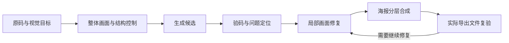

# QR Art Fusion · 插画融合式艺术二维码

**让二维码融进一幅完整插画。**

头发、裙摆、花瓣、珍珠、山石与云雾共同承担画面里的明暗结构。用整体生成建立构图，再通过结构约束、局部修复和实际成品验码，寻找画面与扫码表现的平衡。

An agent skill for illustration-integrated QR art: whole-image generation, structural guidance, local repair, and file-specific scan validation.



这是以 [SKILL.md](SKILL.md) 为入口的方法型 Agent Skill，不包含推理服务、模型权重或一键生成程序。本次发布整理已有制作记录与参考资料，没有重新运行本地模型、扫码测试或手机实验。

## 与 Artistic QR Skill 的区别

| | [Artistic QR Skill](https://github.com/Cream-yj/artistic-qr-skill) | 本仓库 QR Art Fusion |
|---|---|---|
| 主线 | 生成独立物件，再按原矩阵组装 | 整体插画生成，再约束和修复编码结构 |
| 画面单位 | 纽扣、礼盒、金条等可复用素材 | 人物、服装、花卉或山水等连续画面 |
| 结构控制 | 脚本确定格点位置和素材占位 | 生成阶段的结构/明暗条件与后期修复 |
| 常见修改 | 素材形态、占位和高光 | 构图、局部画面、明暗与合成关系 |

两者独立安装，均需核对原码内容和实际交付文件的识别结果。采用生成引导，不代表已经逐像素保留原二维码，也不自动保证扫码。

## 安装与使用

将仓库克隆到支持该格式的 Agent 的技能目录，文件夹名使用 `qr-art-fusion`。例如 Codex：

```bash
mkdir -p "${CODEX_HOME:-$HOME/.codex}/skills"
git clone https://github.com/Cream-yj/qr-art-fusion-skill.git \
  "${CODEX_HOME:-$HOME/.codex}/skills/qr-art-fusion"
```

在能加载该 Skill 的会话中使用 `$qr-art-fusion`；也可以直接提供安装后的 `SKILL.md`。安装这份文档不会下载模型、安装推理依赖或启动模型服务。

### 从零创作

```text
使用 $qr-art-fusion，把我提供的二维码融入花卉和丝绸主题的完整插画。
希望整体有连续构图，弱化方格感；扫码内容沿用原码。
先确认画面方向，再制作，并说明最终 PNG/JPG 和分享文件的实际识别结果。
```

### 修整已确认的作品

```text
使用 $qr-art-fusion，保留这张定稿的脸、手、背景、标题和构图，
只把圈出的灰白补块接成自然的花瓣或珍珠，把暗块融成布料褶皱。
如果该处承担二维码明暗信息，修整时保留其作用，并重新检测成品。
```

### 将已有修整转移到另一版式

```text
图一是认可的定稿；参照图一，把图二相同位置的异常黑白斑也处理掉。
保留图二的边框、背景和比例，优先复用已有修好细节，不重新生成整张图。
```

## 这份 Skill 总结了什么

- 将原码作为实际扫码目标，区分目标矩阵与生成图像。
- 用连续的深浅画面组织编码，而非强制拆成独立小图标。
- 记录结构与明暗控制的模型、控制图、权重和介入区间。
- 判断异常黑白补丁是否承担编码作用，再将其修成自然画面细节。
- 保护定稿区域，使用限定蒙版、原始图层和已认可素材做局部合成。
- 分别检测高清原图、PNG/JPG 与主要分享尺寸，记录失败和未测试项。

`rev_1.2.safetensors` + QR Code Monster v2 + Brightness 是历史上实际使用过的一套本地生成配置；最后的画面还结合了图像编辑工具和局部合成，不能把整套定稿归为该 checkpoint 的一次直接输出。参数和作用见 [生成与后端说明](references/generation.md)。

## Related work 与 References

下列资料在历史调研或本次出处核对中使用。模型、教程、论文和参考工程按各自作用列出；这份 Skill 总结的是制作流程，没有实现新的扩散模型或论文算法。

| 来源 | 在本流程中的作用 |
|---|---|
| [ControlNet — Adding Conditional Control to Text-to-Image Diffusion Models](https://arxiv.org/abs/2302.05543), Zhang et al., 2023 | 条件控制的基础研究 |
| [QR Code Monster v2 for SD 1.5](https://huggingface.co/monster-labs/control_v1p_sd15_qrcode_monster), Monster Labs | 历史使用的二维码条件模型；模型卡也说明生成结果并非总可读 |
| [Brightness ControlNet](https://huggingface.co/latentcat/control_v1p_sd15_brightness), IoC Lab / 模型卡署名 @ciaochaos | 历史使用的明暗控制模型；链接为本次使用的 Diffusers 发布源 |
| [ReV Animated / `rev_1.2.safetensors`](https://huggingface.co/s6yx/ReV_Animated) | 历史主模型的下载源，属于一种配置选择 |
| [AI QR Code 101](https://antfu.me/posts/ai-qrcode-101), Anthony Fu 等 | 艺术二维码生成、控制介入时机与识别差异的实践参考 |
| [DiffQRCoder](https://openaccess.thecvf.com/content/WACV2025/html/Liao_DiffQRCoder_Diffusion-Based_Aesthetic_QR_Code_Generation_with_Scanning_Robustness_Guided_WACV_2025_paper.html), Liao et al., WACV 2025 · [项目页](https://jwliao1209.github.io/DiffQRCoder/) | 扫描鲁棒性引导和迭代优化的相关研究；本仓库未实现或复现其 SRPG / SR-MPGD |
| [Qraft](https://github.com/sergiocrol/qraft) | SD + 双 ControlNet 的参考工程；未复现其服务部署与修复实现 |
| [DENSO WAVE：二维码码区与静区](https://www.qrcode.com/en/howto/code.html) | 四模块静区等基础几何要求 |
| [OpenCV WeChat QRCode](https://github.com/opencv/opencv_contrib/tree/4.x/modules/wechat_qrcode) · [ZXing-C++](https://github.com/zxing-cpp/zxing-cpp) | 历史验码使用的独立识别路径；具体版本与参数应随本次任务记录 |

历史起点还包括用户提供的艺术二维码教程截图。原帖的可核验链接未保存在本次文档中，因此不编造原帖引用，也不转载截图或将其中配方冒认原创。更完整的来源关系见 [references/sources.md](references/sources.md)。

## 历史经验与结果边界

匿名化历史案例中，六处异常黑白斑被接成发丝、花瓣、珍珠和丝绸暗部，背景、边框、脸和手保持原有内容。最终方形 PNG/JPG 的本地结果为：

| 实际文件 | Apple Vision | Apple CoreImage | ZXing-C++ | OpenCV WeChat |
|---|---|---|---|---|
| 1200×1200 PNG / JPG | 通过 | 通过 | 未通过 | 通过 |
| 768×768 分享 PNG / JPG | 未通过 | 通过 | 通过 | 通过 |

这些是**历史记录的摘要**：每种尺寸为 3/4 路径通过，失败的路径并不相同，且未进行真实手机、目标应用或印刷实测。原始私有码图和日志未随仓库公开，因此这张表不是可由仓库附件重新验证的公开 benchmark，也不是本次文档发布重新跑出的成绩。

经验与证据范围见 [references/history.md](references/history.md)。新的二维码、尺寸、缩放方法和压缩条件必须生成各自的结果，不能沿用上述计数。

## 文档入口

| 文件 | 何时阅读 |
|---|---|
| [SKILL.md](SKILL.md) | Agent 的入口、流程与边界 |
| [references/generation.md](references/generation.md) | 选择生成后端、理解历史双 ControlNet 配置 |
| [references/repair.md](references/repair.md) | 修补明暗瑕疵、保护定稿、转移已有修整 |
| [references/validation.md](references/validation.md) | 记录实际成品的解码结果与未测条件 |
| [references/few-shot.md](references/few-shot.md) | 按用户请求选择操作的例子 |
| [references/history.md](references/history.md) | 历史实际做过什么、哪些结论仍有限 |
| [references/sources.md](references/sources.md) | 方法、模型与参考工程的出处和使用关系 |

本次发布仅做文档结构、内部链接和公开内容检查，没有运行模型推理、行为回归或新的二维码实验。未来使用者仍需具备所选生成/编辑工具、合成环境和解码器。

## License

Skill 文档与本仓库原创内容采用 [MIT](LICENSE)。被引用的模型、软件、论文和第三方图片分别适用各自的许可；本仓库不分发模型权重、客户二维码、真实落地链接或参考截图。
